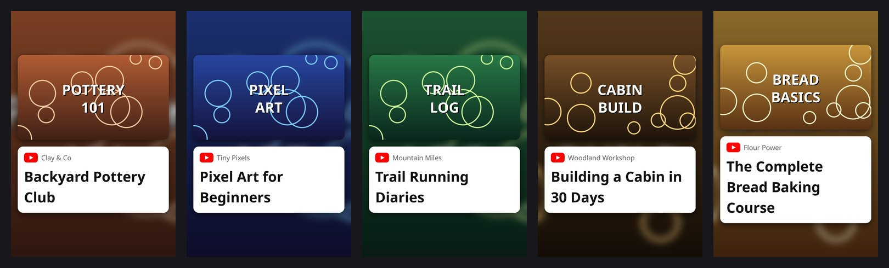
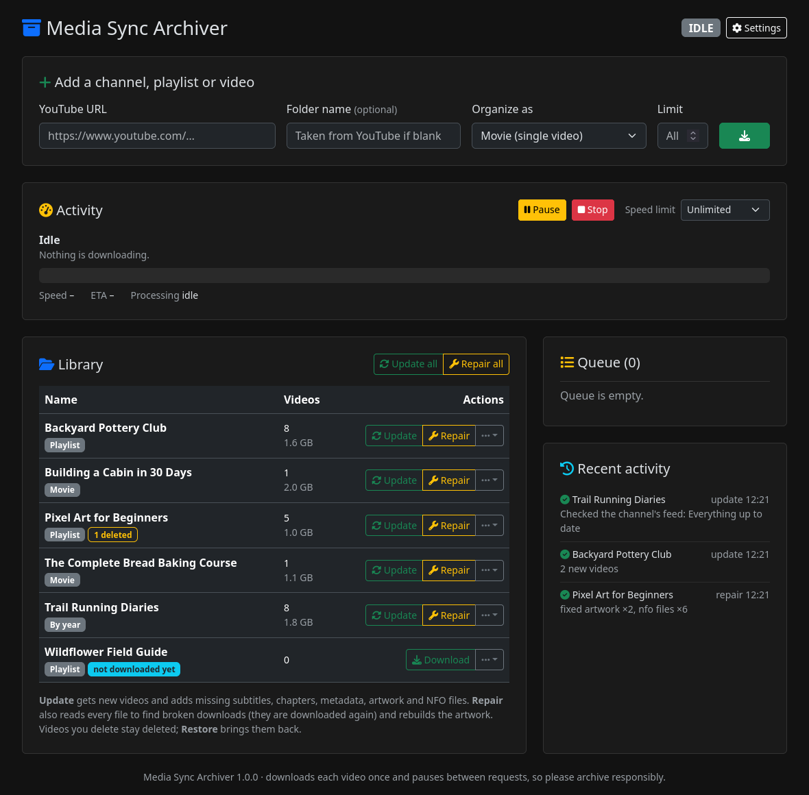

# Media Sync Archiver

Keep your favourite YouTube channels, playlists and videos as a tidy **offline library for Kodi**
(Jellyfin works too). Each video is downloaded once and organised like a real TV show or movie:
episode numbers, descriptions, subtitles, chapters and posters, ready to watch when you have no
internet. Updates fetch only what is new or missing.



## What it does

- **Playlists become TV shows** in playlist order, **channels become TV shows** with one season per
  year, and **single videos become movies**.
- Writes everything Kodi needs: `.nfo` files, episode thumbnails, posters with the title on them,
  fanart, and season posters. Subtitles, chapters and tags are embedded in the video files.
- **Update** gets new videos and fills in anything missing. **Repair** reads every file to find broken
  downloads and fixes them. **Restore** brings back videos you deleted.
- Downloads and processing run side by side: the next video downloads while the last one is
  being finished.
- **Several libraries**, for example one on this computer and one on an external drive. While a drive
  is unplugged its shows are left alone, never downloaded again somewhere else.
- A web dashboard to manage everything, plus terminal commands for scheduled jobs.

## What it's for (and what it isn't)

Media Sync Archiver can download whole channels and playlists, but it's built for keeping a personal
offline copy of the shows you care about, not for scraping YouTube. It works through your
subscriptions one at a time at a deliberately slow pace (see [how](#how-it-keeps-youtube-requests-low)),
never downloads the same video twice, and doesn't try to get around YouTube's limits or blocks. It isn't
meant for mass-collecting videos or data, or for re-uploading or sharing other people's content.
Please support the creators you archive, and respect their wishes and YouTube's terms in your country.

## Install

You need **Python 3.10 or newer**, **ffmpeg**, and a **JavaScript runtime** (YouTube requires one to
unlock all video formats; [Deno](https://deno.com) is recommended, Node.js works too).

| | Linux (Debian/Ubuntu/Mint) | macOS | Windows |
|---|---|---|---|
| Python | usually installed; also `sudo apt install python3-venv` | `brew install python` | [python.org](https://www.python.org/downloads/) |
| ffmpeg | `sudo apt install ffmpeg` | `brew install ffmpeg` | `winget install Gyan.FFmpeg` |
| Deno | `curl -fsSL https://deno.land/install.sh \| sh` | `brew install deno` | `winget install DenoLand.Deno` |

Then download Media Sync Archiver, either with git:

```
git clone https://github.com/pink-kitsune-420/media-sync-archiver.git
```

or with the green **Code › Download ZIP** button on GitHub (unzip it anywhere you like).

## Start it

Open a terminal in the `media-sync-archiver` folder and run:

```
python3 run.py
```

(On Windows: `py run.py`.) The dashboard opens in your browser at http://localhost:8765. Keep the
terminal open while you use it; press `Ctrl+C` in it to stop the app.

The first start takes a minute: `run.py` creates a private Python environment in a `.venv` folder
inside the project and installs what the app needs into it. Nothing outside the project folder is
changed (no system packages, no PATH changes), and deleting the folder removes everything except your
videos and settings.

**Updating:** download the new version (`git pull`, or a fresh ZIP), then start it with
`python3 run.py --upgrade`, which also updates yt-dlp. YouTube changes often, so do this whenever
downloads start failing.

> Developed and tested on Linux. Windows and macOS should work but have had less testing; reports welcome.

## Set up Kodi

1. Paste a playlist, channel or video URL into the dashboard and press the download button.
2. In Kodi, go to **Videos › Files › Add videos** and add two sources:

   | Folder (default) | This directory contains | Information provider |
   |---|---|---|
   | `~/Videos/YouTube/Shows` | TV shows | Local information only |
   | `~/Videos/YouTube/Movies` | Movies | Local information only |

3. That's it. New downloads appear after Kodi's next library update. Optionally let the app trigger
   that for you (Settings › Kodi).

If you add more libraries (see below), add each library's Shows and Movies folders the same way.

**Jellyfin:** add the same folders as a *Shows* and a *Movies* library. Jellyfin reads the `.nfo` files
and artwork too.

## Using the dashboard



| Button | What it does | Talks to YouTube? |
|---|---|---|
| **Update** | New videos, plus anything missing from existing ones (subtitles, metadata, chapters, artwork, NFOs). Files that cannot be played are downloaded again. | Only for what is new or missing |
| **Repair** | Everything Update does, plus reads every file completely to catch corrupt or truncated downloads, and rebuilds the artwork. | Same as Update, plus re-downloads of broken files |
| **Restore** | Downloads the videos you deleted from the library again. | Only for those videos |
| **Update all** | Update for every subscribed show, one at a time (movies are skipped: they never get new videos). | Same as Update, for each show |
| **Repair all** | Repair for everything in the library, including items you've unsubscribed from. | Same as Repair, for each item |
| **Download again** | Only offered when a show's folder has gone missing: downloads all of it again from scratch. | Yes, everything |
| **Subscribe** / **Unsubscribe** | In the "…" menu: include a show in Update all, or stop updating it (its files are kept). If its YouTube address isn't known, Subscribe asks for it. | No |
| **Move to …** | In the "…" menu: moves a show or movie to another library, e.g. onto an external drive. | No |
| **Folders** | In the "…" menu: put shows in folders of your own to keep a long list tidy (the files don't move). Folders can be collapsed, renamed and removed; the search box finds things inside them too. | No |
| **Delete leftovers** | Only offered for files left over from a download that didn't finish, when the show itself isn't in a connected library. | No |

Videos you delete yourself **stay deleted**: Update never downloads them again, and the other episodes
keep their numbers. The library list shows how many were deleted, and Restore brings them back in
their old place.

## Libraries and external drives

A library is a Shows folder plus a Movies folder. You start with one; add more under
**Settings › Libraries**, e.g. *External Drive* with `/media/you/ExternalDrive/YouTube/Shows` and
`/media/you/ExternalDrive/YouTube/Movies`. When you add something, you choose which library it goes in.

- **Unplugged drives are safe.** A library whose folders can't be found is shown as *not connected*:
  its shows are collapsed into one line at the bottom of the list (click it to see them), and
  Update all, Repair all and automatic checks skip them.
  Nothing is downloaded for them and nothing is created where the drive was. Plug the drive in and
  they're back.
- **Moving between libraries:** use **Move to …** in a show's "…" menu (or
  `python3 run.py move NAME --to LIBRARY`). On another drive the files are copied first and the
  originals are only removed once the copy is complete, so an interruption leaves the show as it was.
  In Kodi a moved show appears from its new place, so its watched status starts over.
- **Moving folders yourself is fine too.** If you move a show's folder to another library, the app
  finds it there and keeps updating it in its new place.
- **Download once, even then.** If a show you downloaded before can't be found anywhere, it's marked
  *folder missing* instead of being downloaded again. Use **Download again** only if you really
  want to start over.
- New downloads wait in the app's downloads folder on this computer and are moved into the library
  when they're finished.

## Command line

Everything the dashboard does also works from a terminal (in the project folder):

```
python3 run.py                          open the dashboard
python3 run.py add URL [--as movie|playlist|years] [--name NAME] [--limit N] [--library NAME]
python3 run.py update [NAME ...]        update every subscribed show, or just these
python3 run.py update --download-again NAME   download a show whose folder is missing from scratch
python3 run.py repair [NAME ...]        repair the whole library, or just these
python3 run.py restore NAME ...         download deleted videos again
python3 run.py move NAME ... --to LIBRARY     move shows/movies to another library
python3 run.py list                     what is subscribed and in the library
python3 run.py clean                    remove leftover junk and unfinished downloads (asks first)
python3 run.py config                   where settings, libraries and logs are
```

`python3 run.py update` works well as a nightly cron job or scheduled task. The dashboard can also
check automatically (Settings › Check for new videos).

## How your library is organised

```
Shows/
  Backyard Pottery Club/                    a playlist: one season, in playlist order
    tvshow.nfo  poster.jpg  fanart.jpg  landscape.jpg  season01-poster.jpg
    Season 01/
      S01E01 - Wedging Clay [aBcD3fGh1jK].mkv
      S01E01 - Wedging Clay [aBcD3fGh1jK].nfo
      S01E01 - Wedging Clay [aBcD3fGh1jK]-thumb.jpg
  Trail Running Diaries/                    a channel: one season per year
    Season 2023/
      S2023E031501 - Night Run [xYz...].mkv  (15 March, 1st video that day)
Movies/
  Building a Cabin in 30 Days/
    Building a Cabin in 30 Days [qRs...].mkv  (+ .nfo, -poster.jpg, -fanart.jpg)
```

- Playlist episodes are numbered in playlist order. Videos you deleted keep their number; videos that
  were never downloadable (private or deleted on YouTube) don't get one.
- Channel episodes are numbered by upload date, so numbers never change when new or older videos are
  added later (Kodi keeps your watched status).
- The `[id]` in each file name is the YouTube video ID; it's how the app recognises a video.
- Each show keeps a hidden `.metadata` folder with the video information, so the library can be moved
  or copied to another computer as-is.

## How it keeps YouTube requests low

- **Download once.** Videos already in the archive, or deleted by you, are never downloaded again.
- **Cheap new-video checks.** For a channel, an update first reads the channel's RSS feed (one small
  request) and only looks further if that shows something new, stopping at the first video it
  already has. A playlist check is about one request per 100 videos.
- **Only what's missing.** Metadata and subtitles are only fetched for videos that lack them, and
  thumbnails come straight from YouTube's image server. If YouTube refuses subtitles, Update waits a
  day before trying again (then 3 days, then a week if it keeps failing); Repair retries right away.
- **Gentle mode** (on by default) pauses between requests and downloads, the same as yt-dlp's own
  `sleep` preset.
- **No background polling** unless you switch on automatic checks (at most every 6 hours).

## Settings

Everything can be changed on the dashboard's **Settings** page or in `config.toml`
(`python3 run.py config` shows where it is: `~/.config/mediasync/` on Linux, `%APPDATA%\mediasync` on Windows,
`~/Library/Application Support/mediasync` on macOS). Libraries, maximum quality (default 1080p),
subtitle languages, speed limit, gentle mode, automatic checks, who can open the dashboard, the
optional Kodi rescan, and a detailed log. Set `MEDIASYNC_HOME` to keep settings and downloads somewhere else (e.g. a USB drive).

## Troubleshooting

- **Logs:** the terminal only shows the important lines. Everything else (file renames, yt-dlp's
  messages, full error details) goes to the `logs` folder next to your settings, one file per day
  (`python3 run.py config` shows where). Switch on *Settings › Detailed log* to also record every
  YouTube request; attach that day's log file when you report a problem.
- **Disk full:** downloading pauses by itself. Free up some space, then press *Resume*.
- **A show says "drive not connected" or "folder missing":** plug in the drive it's on (or move its
  folder back), then refresh. A new drive without library folders yet: press *Create folders* next
  to it under Settings › Libraries.
- **"Sign in to confirm you're not a bot", HTTP 403 or 429 errors:** make sure Deno (or Node.js) is
  installed, keep gentle mode on, and update yt-dlp: `python3 run.py --upgrade`.
  YouTube changes often, and a fresh yt-dlp usually fixes it.
- **Kodi still shows old artwork:** Kodi caches images. Open the item's info and choose *Refresh*.
- **Open the dashboard from your phone or TV:** set *Who can open this page* to *Any device on my home
  network* and restart. There is no password, so only do this on a network you trust.
- **A video is missing subtitles:** YouTube sometimes refuses subtitle downloads for a while; Update
  tries again the next day (waiting longer if it keeps failing) and Repair tries right away.

## About this project

Media Sync Archiver started as a personal tool to keep tutorial playlists and favourite channels
available offline in Kodi. It was written with a lot of help from AI coding assistants, then
tested on a real library. It's shared as-is in the hope that it's useful.

Built on [yt-dlp](https://github.com/yt-dlp/yt-dlp), [ffmpeg](https://ffmpeg.org),
[Flask](https://flask.palletsprojects.com) and [Pillow](https://python-pillow.org).
Library conventions follow the [Kodi wiki](https://kodi.wiki/view/Naming_video_files/TV_shows).

### Development

```
git clone https://github.com/pink-kitsune-420/media-sync-archiver.git
cd media-sync-archiver
python3 run.py --version
.venv/bin/python -m unittest discover -s tests -t .
```

The tests use small generated videos and a fake YouTube, so they run offline (ffmpeg required).
If you prefer installing it as a regular command, `pipx install .` gives you `mediasync`.

## Disclaimer

Media Sync Archiver is not affiliated with, endorsed by or sponsored by YouTube, Google or the Kodi
project. YouTube and the YouTube logo are trademarks of Google LLC, and Kodi is a trademark of the XBMC
Foundation; they are only used to describe what this software works with (the small badge on posters
marks where a video came from). The software is provided "as is" (see the license). You are
responsible for what you download with it: only archive videos you are allowed to keep, and follow
YouTube's terms and the copyright laws where you live.

## License

[MIT](LICENSE)
